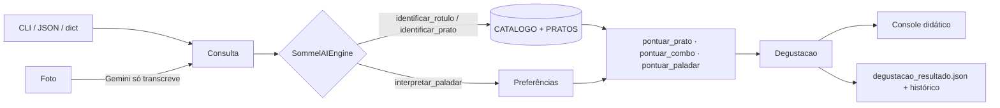

<div align="center">

# TerroirMind AI

**Do terroir à mente, do gole à memória.**

*Uma inteligência sommelier para Vinhos, Destilados, Charutos e Cafés Especiais,
que identifica, harmoniza e, acima de tudo, ensina.*

Idealizado e criado por **Herbert Felipe**

### [Abrir o TerroirMind no navegador](https://herbert-emidio.github.io/TerroirMind/)

*Funciona no celular, sem instalar nada.*

[](https://github.com/HERBERT-EMIDIO/TerroirMind/actions/workflows/testes.yml)


</div>

---

## A ideia

Todo mundo já ficou parado diante de uma carta de vinhos sem saber o que pedir. Ou ganhou um charuto e não sabia como cortar. Ou ouviu alguém dizer que um café tinha "notas de jasmim" e achou que era exagero.

O **TerroirMind AI** nasceu para acabar com esse silêncio. É um sommelier de bolso que reúne quatro ofícios num só cérebro:

- **Sommelier de vinhos**, que lê o rótulo e explica a taça.
- **Master blender de destilados**, que conta o que a madeira fez com o whisky, a cachaça e o cognac.
- **Cigar sommelier**, que ensina bitola, capa, corte e acendimento.
- **Q-Grader de cafés especiais**, que traduz processo, torra e pontuação SCA em xícara.

A proposta de valor cabe numa frase: **transformar jargão em experiência**. Em vez de "taninos firmes e retrogosto persistente", o TerroirMind diz *"seca a boca como casca de uva mastigada, e o sabor fica conversando com você por meio minuto"*. E sempre mostra **por que** uma harmonização funciona, regra por regra, para que você aprenda e um dia não precise mais dele.

O projeto tem sotaque nordestino de propósito: o catálogo conhece o Syrah do Vale do São Francisco, a cachaça de Vitória de Santo Antão, o café sombreado de Taquaritinga do Norte, o bolo de rolo e a cartola.

## O que ele faz

| Consulta | Você informa | Você recebe |
|---|---|---|
| **Análise de Rótulo** | O nome do rótulo ou uma foto | Identificação, perfil sensorial explicado, dica de serviço e os pratos que combinam |
| **Harmonização por Prato** | O prato do dia | O ranking de bebidas (ou charutos) com nota de 0 a 100 e os motivos |
| **Sugestão por Paladar** | Como você gosta ("doce, frutado, pouco amargo") | O estilo com mais afinidade, as alternativas e os pratos para ele |
| **Combo Vícios Elegantes** | Um charuto, ou uma bebida ou café | O par charuto + bebida/café, com destilado, café e fortificado lado a lado |

Toda resposta traz três blocos fixos:

1. **Descrição Didática:** aromas, ataque, corpo, acidez, doçura, taninos/força/amargor, intensidade e retrossabor, cada um com uma escala de 1 a 5 e uma comparação do dia a dia.
2. **Dica de Serviço:** temperatura, taça ou método, decantação, receita de extração ou ritual de corte e acendimento.
3. **Harmonização Recomendada:** sugestões pontuadas e justificadas.

## Os 4 pilares

| Pilar | O que o TerroirMind avalia | Exemplos no catálogo | Escala de "estrutura" |
|---|---|---|---|
| **Vinhos** | Corpo, acidez, doçura, taninos, intensidade e persistência | Cabernet Sauvignon, Merlot, Pinot Noir, Malbec, Syrah do Vale do São Francisco, Chardonnay, Sauvignon Blanc, Rosé, Espumante Brut, Moscatel, Porto Tawny, Dom Pérignon | **Taninos**: a secura na gengiva |
| **Destilados** | Corpo, doçura, calor alcoólico, intensidade, madeira e idade | Single Malt de Speyside e de Islay, Bourbon, Cachaça de carvalho, de amburana e prata, Cognac VSOP, Gin London Dry, Rum, Lagavulin 16, Glenfiddich 12, Maker's Mark, Pitú | **Calor alcoólico**: o abraço (ou a brasa) do álcool |
| **Charutos** | Corpo da fumaça, doçura, fortaleza, bitola, capa e tempo de fumo | Robusto Connecticut, Corona Cubana, Toro Maduro da Nicarágua, Charuto Baiano Mata Fina, Cohiba Siglo VI, Montecristo No. 2, Partagás D4, Romeo y Julieta Churchill | **Fortaleza**: a presença de nicotina |
| **Cafés** | Corpo, acidez, doçura, amargor, processo, torra e pontuação SCA | Cerrado Mineiro Natural, Etiópia Yirgacheffe Lavado, Fermentado Anaeróbico, Mantiqueira Cereja Descascado, Agreste Pernambucano, Geisha do Panamá, Espresso de torra escura | **Amargor**: da fruta brilhante ao chocolate 85% |

O manual completo, escrito para quem nunca provou nada com atenção, está em [`GUIA_SOMMELIER_DIDATICO.md`](GUIA_SOMMELIER_DIDATICO.md).

## No navegador

Abra **[herbert-emidio.github.io/TerroirMind](https://herbert-emidio.github.io/TerroirMind/)**. A página roda o próprio `sommelai_engine.py` dentro do navegador (com [Pyodide](https://pyodide.org)), então as respostas são as mesmas da linha de comando. Na primeira visita o motor leva alguns segundos para carregar.

- Escolha o tipo de consulta, a categoria e escreva (ou toque em um exemplo).
- **Foto do rótulo:** pela câmera do celular, com uma chave grátis do Gemini salva só no seu navegador. O Gemini apenas transcreve o rótulo.
- **Copiar link desta consulta** gera um endereço que abre direto no resultado, bom para mandar aos amigos. Exemplo: [picanha na brasa](https://herbert-emidio.github.io/TerroirMind/?tipo=prato&entrada=Picanha%20na%20brasa).
- As abas **Catálogo** e **Manual** trazem tudo o que o motor conhece e o guia completo.

## Início rápido

Precisa apenas de **Python 3.10 ou mais novo**. Não há nada para instalar: o motor usa só a biblioteca padrão.

```bash
git clone https://github.com/HERBERT-EMIDIO/TerroirMind.git
cd TerroirMind
python sommelai_engine.py
```

Sem argumentos, ele harmoniza o prato padrão (carne de sol com macaxeira) e grava `degustacao_resultado.json`.

### As quatro consultas

```bash
# 1. Análise de Rótulo (texto)
python sommelai_engine.py --tipo rotulo --entrada "Lagavulin 16"

# 2. Harmonização por Prato
python sommelai_engine.py --tipo prato --categoria vinho --entrada "picanha na brasa"

# 3. Sugestão por Paladar
python sommelai_engine.py --tipo paladar --categoria cafe --entrada "doce, com chocolate e pouco amargo"

# 4. Combo Vícios Elegantes
python sommelai_engine.py --tipo combo --entrada "Cohiba Siglo VI"
```

`--tipo` aceita a forma curta (`rotulo`, `prato`, `paladar`, `combo`) ou o nome completo (`"Análise de Rótulo"`). `--categoria` aceita `Vinho`, `Destilado`, `Charuto` ou `Café`, com ou sem acento; vazio procura em todas.

### Por arquivo JSON

```bash
python sommelai_engine.py --config consulta_exemplo.json
```

```json
{
  "tipo_consulta": "Combo Vícios Elegantes (Charuto + Bebida/Café)",
  "categoria": "Charuto",
  "entrada": "Romeo y Julieta Churchill",
  "imagem": ""
}
```

A linha de comando sobrescreve o JSON. O próprio `degustacao_resultado.json` exportado também pode voltar como `--config` para repetir uma consulta.

### Por foto do rótulo

```powershell
# Windows (PowerShell)
$env:GEMINI_API_KEY = "sua-chave"
python sommelai_engine.py --tipo rotulo --imagem fotos/meu-vinho.jpg
```

```bash
# Linux / macOS
export GEMINI_API_KEY="sua-chave"
python sommelai_engine.py --tipo rotulo --imagem fotos/meu-vinho.jpg
```

A foto vai para o Gemini, que **apenas transcreve** o que está escrito no rótulo. O perfil sensorial, as notas e as harmonizações saem sempre do catálogo e das regras do motor, nunca do modelo de linguagem. Assim o TerroirMind não inventa sabor. Sem a chave, o motor usa o nome do arquivo como texto (`lagavulin-16.jpg` vira "lagavulin 16"). `GEMINI_MODEL` troca o modelo (padrão: `gemini-flash-latest`).

### Preços de referência

Depois de dizer *o que* beber, o TerroirMind pode dizer *onde* encontrar e *quanto* custava. Os preços vêm de `precos_referencia.csv`, uma tabela que você mesmo preenche: com o que viu no site da [DLP Vinhos](https://www.dlpvinhos.com.br/), na prateleira ou na nota fiscal.

```text
chave;loja;produto;preco;data;cidade;link
syrah;DLP Vinhos;Nome do Syrah 750 ml;89,90;2026-10-11;Recife/PE;https://www.dlpvinhos.com.br/
```

- `chave` é a chave do catálogo (aparece em `--listar`). Um estilo pode apontar para uma garrafa de exemplo; um rótulo, para ele mesmo.
- A mesma chave pode ter várias ofertas: o motor mostra as duas mais baratas, para o protagonista e para cada bebida ou charuto sugerido.
- Preço com mais de 30 dias aparece com um aviso para conferir. Linha com chave, preço ou data errados vira aviso e fica de fora.

```bash
python sommelai_engine.py --listar precos          # confere a tabela e os avisos
python sommelai_engine.py --precos outra_loja.csv  # usa outro arquivo
```

O motor **não raspa sites de lojas**. A DLP Vinhos bloqueia robôs de IA no `robots.txt` e o TerroirMind respeita isso. Se a loja um dia oferecer um arquivo de preços, basta convertê-lo para esse formato.

### Outras opções

| Opção | O que faz |
|---|---|
| `--listar [categoria\|pratos\|precos]` | Mostra o catálogo (com as chaves), os pratos ou a tabela de preços e sai |
| `--precos arquivo.csv` | Usa outra tabela de preços (padrão: `precos_referencia.csv`) |
| `--top N` | Quantas sugestões listar (1 a 10, padrão 3) |
| `--output caminho.json` | Grava o resultado em outro arquivo |
| `--json-only` | Imprime o JSON no console e não grava arquivo (útil para web e mobile) |
| `--sem-historico` | Grava o JSON sem carregar o histórico anterior |

### Como biblioteca

```python
from sommelai_engine import SommelAIEngine

engine = SommelAIEngine(top=3)
resultado = engine.consultar_dict({
    "tipo_consulta": "Sugestão por Paladar",
    "categoria": "Destilado",
    "entrada": "não gosto de amargo nem de forte, prefiro doce e baunilha",
})
print(resultado["protagonista"]["nome"])
```

Sem o argumento `precos`, o motor lê `precos_referencia.csv` ao lado do script. Para outra tabela: `SommelAIEngine(precos=carregar_precos(Path("outra.csv"))[0])`.

## Exemplo de saída

```text
════════════════════════════════════════════════════════════════════════════
  TerroirMind AI · Harmonização por Prato · Vinho
  Do terroir à mente, do gole à memória.  (Herbert Felipe)
════════════════════════════════════════════════════════════════════════════
  Entrada:            picanha na brasa
  Prato:              Picanha na brasa (peso 4/5, gordura 4/5, acidez 0/5,
                      doçura 0/5, sal 3/5)

◆ SYRAH / SHIRAZ
  Estilo:             Vinho · Tinto intenso e especiado
  Origem:             Vale do Rhône (França), Barossa (Austrália), Vale do
                      São Francisco (PE/BA, Brasil)
  “Pimenta e amora dançando um xaxado: intensidade com ginga nordestina.”

── Descrição didática ──────────────────────────────────────────────────────
  Corpo:              ●●●●○  Como leite integral: denso, cobre a língua como
                      veludo.
  Taninos:            ●●●●○  Taninos firmes: secam a boca como casca de uva
                      mastigada.
  Retrossabor:        ●●●●○  Pimenta, defumado e amora, longo e quente.
                      Longa: 20 a 40 segundos de memória.

── Dica de serviço ─────────────────────────────────────────────────────────
  Temperatura:        16–18 °C.
  Taça:               Taça Bordeaux ou de bojo amplo.
  Decantação:         Decante 30 min se for jovem.

── Harmonização recomendada · Picanha na brasa ─────────────────────────────
  1. Syrah / Shiraz [Vinho] · 82/100 · Ótima companhia
       · Peso com peso: bebida e prato têm a mesma intensidade (4/5).
       · Contraste: os taninos limpam a gordura e preparam a próxima garfada.
       · Ponte aromática: defumado aparece nos dois lados.
  2. Cabernet Sauvignon [Vinho] · 78/100 · Ótima companhia
  3. Malbec [Vinho] · 78/100 · Ótima companhia
```

*(trecho; a saída completa traz aromas, ataque, acidez, doçura, intensidade e os motivos de cada sugestão)*

## Arquitetura

O motor segue o mesmo desenho do meu planejador de maratona para Garmin: **um script, dados em catálogos, regras em funções puras, CLI que sobrescreve o JSON e um JSON de saída que alimenta qualquer interface.**



| Peça | Papel |
|---|---|
| `CATALOGO` | Fichas `Perfil` com níveis de 1 a 5, aromas, ataque, retrossabor, serviço, poesia e ficha técnica. **Estilos** (sem marca) alimentam as sugestões; **rótulos** (com marca) são alvos de identificação. |
| `PRATOS` | Fichas `Prato` com peso, gordura, acidez, doçura, picância, sal, famílias aromáticas e momento (principal, entrada, petisco, sobremesa, manhã). |
| `localizar` | Identificação por apelido (confiança alta), por semelhança de escrita (média) ou por pista ("vinho tinto" vira Merlot de referência, confiança baixa). |
| `pontuar_prato` | As regras de ouro da Seção C do guia: peso com peso, gordura pede acidez/taninos/bolhas, doce pede doce, sal ama doce e bolhas, pimenta foge de tanino e álcool, taninos com peixe dão gosto metálico, ponte aromática e "o que cresce junto, combina junto" (bônus para prato e bebida da mesma terra). |
| `pontuar_combo` | Fortaleza do charuto contra a intensidade da bebida, pontes aromáticas e o método de Walter Saes, campeão mundial de Habano Sommelier: doçura contra o amargor, álcool por volta de 40%, espumante só com charuto suave e tinto que "acompanha, mas não casa". |
| `interpretar_paladar` | Lê português livre, com negação ("pouco amargo", "não gosto de forte") e reforço ("muito doce"). |
| `Degustacao` | Renderiza o console e exporta o JSON com o histórico (mais recente primeiro, até 50 consultas). |

### O JSON exportado

```text
degustacao_resultado.json
├── meta            projeto, versão, autor, data
├── consulta        tipo_consulta, categoria, entrada, imagem
├── identificacao   texto lido, método, confiança, observação
├── prato           ficha do prato (Harmonização por Prato)
├── preferencias    alvos e famílias (Sugestão por Paladar)
├── protagonista
│   ├── descricao_didatica   aromas, ataque, eixos[1..5], retrossabor, poesia
│   ├── dica_servico         temperatura, utensilio, ritual (com rótulo por categoria)
│   └── classicos
├── harmonizacao    titulo + sugestoes[nome, categoria, nota, veredito, motivos]
├── alternativas    afinidade com o paladar
├── onde_encontrar  ofertas[loja, produto, preco, data, dias, conferir] por item sugerido
└── historico       resumo das consultas anteriores
```

As chaves são fixas para que uma interface web ou mobile consiga ler qualquer consulta sem condicional por categoria.

## Estrutura do repositório

```text
TerroirMind/
├── README.md                     você está aqui
├── index.html                    o site (GitHub Pages)
├── assets/app.js, app.css        interface; carrega o motor com Pyodide
├── GUIA_SOMMELIER_DIDATICO.md    o manual para iniciantes (Seções A, B e C)
├── sommelai_engine.py            o motor (SommelAIEngine), só biblioteca padrão
├── consulta_exemplo.json         entrada de exemplo para --config
├── precos_referencia.csv         preços anotados à mão (onde encontrar e quanto custa)
├── degustacao_resultado.json     saída gerada pelo motor, com histórico
├── LICENSE                       MIT
├── .github/workflows/testes.yml  testes automáticos a cada push (Python 3.10 e 3.13)
└── .cursor/rules/                convenções do projeto para o Cursor
```

## Roadmap

- [x] Página web estática (GitHub Pages) rodando o próprio `sommelai_engine.py` no navegador com Pyodide, como no planejador de maratona.
- [x] Câmera no celular para fotografar o rótulo direto da página.
- [ ] Mais rótulos brasileiros, com ficha do produtor: espumantes da Serra Gaúcha, tintos do Vale do São Francisco, cachaças de alambique e cafés de microlote.
- [ ] Diário de degustação: transformar o `historico` em um caderno de provas com notas pessoais.
- [ ] Modo "aula": um roteiro de degustação guiada, passo a passo, a partir do guia.
- [ ] Tabela de preços enviada pela própria loja (DLP Vinhos ou outra), no formato de `precos_referencia.csv`.

## Como contribuir

Contribuições são muito bem-vindas, sobretudo de quem entende de uma taça, de um charuto ou de uma xícara.

1. Faça um **fork** do repositório e crie uma branch: `git checkout -b catalogo/cachaca-salinas`.
2. Faça a mudança no lugar certo:
   - **Novo estilo ou rótulo:** uma entrada `Perfil` em `CATALOGO`. Rótulo novo só com a ficha técnica do produtor citada no PR. Descrições sensoriais em linguagem simples, como no resto do catálogo.
   - **Novo prato:** uma entrada `Prato` em `PRATOS` (use `maritimo=True` para peixes e frutos do mar).
   - **Nova regra de harmonização:** em `pontuar_prato`, `pontuar_combo` ou `pontuar_paladar`, sempre com um motivo em português. Toda regra nova também entra na Seção C do guia.
   - **Nova palavra de paladar:** em `PALADAR_EIXOS` ou `PALADAR_FAMILIAS`.
3. Rode o motor e confira que os clássicos continuam no topo: picanha com Syrah, ceviche com Sauvignon Blanc, queijo azul com Porto Tawny, frituras com Espumante Brut, bolo de rolo com café.
   ```bash
   python sommelai_engine.py --tipo prato --entrada "picanha"
   python sommelai_engine.py --tipo prato --entrada "queijo azul"
   ```
4. Abra o **Pull Request** explicando o que mudou e por quê. Commits e textos em português.

Regras da casa: nada de dependência externa no motor, nada de sabor inventado pela IA, nada de raspagem de site de loja ou de dados de API sem licença, e respeito com quem está começando.

## Consumo responsável

O TerroirMind é um projeto educativo sobre cultura sensorial. Bebidas alcoólicas e charutos são para **maiores de 18 anos**. Beba com moderação, nunca dirija depois de beber, e lembre que o tabaco faz mal à saúde: charuto é ritual ocasional, não hábito.

## Licença e autoria

Distribuído sob a licença [MIT](LICENSE).

**TerroirMind AI** é uma ideia original de **Herbert Felipe**, da concepção do conceito à curadoria do catálogo e ao desenho do motor. Se usar, cite. Se melhorar, compartilhe.

<div align="center">

*Cada taça guarda um lugar. Cada gole conta a sua história.*

</div>
